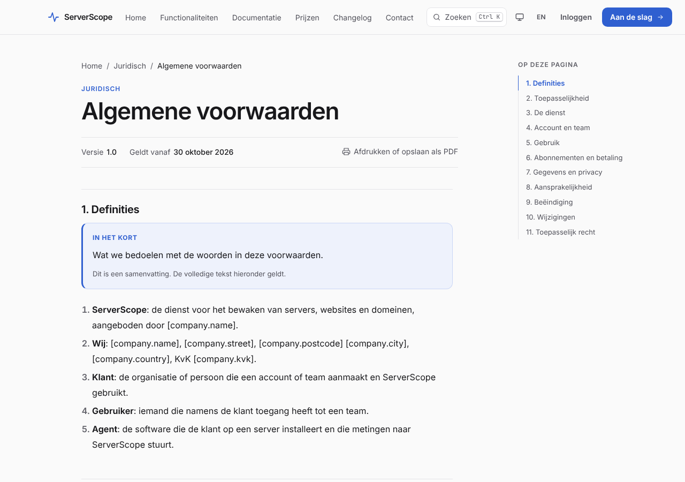
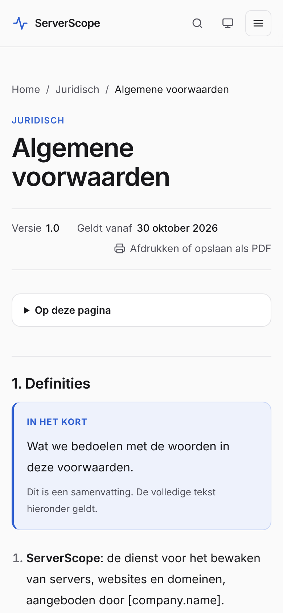

# Oplevering fase 3: juridisch, SEO en AI-vindbaarheid

Branch: `claude/legal-seo-ai` (gemaakt vanaf `claude/relaxed-hypatia-rm4ddm`, dus
bovenop pull request #1). Niets staat live. Alle migraties voegen alleen toe.
Er zijn geen nieuwe Composer- of npm-pakketten.

## 1. Wat er gemaakt is

### Juridisch

- **Zeven documenten, NL en EN**: privacyverklaring, cookieverklaring, colofon,
  algemene voorwaarden, verwerkersovereenkomst (met bijlage subverwerkers en
  beveiligingsmaatregelen), acceptabel gebruik en responsible disclosure.
- Beheer onder **Inhoud → Juridisch**: versienummer, ingangsdatum, wijzigingen per
  versie, revisiegeschiedenis met verschillen, terugzetten, voorbeeld.
- Alle teksten staan als **concept**. In Filament staat bij elk concept
  "Concept: nog niet juridisch gecontroleerd". Op de site verschijnt een document
  pas na publicatie.
- **Publiceren is geblokkeerd** zolang verplichte bedrijfsgegevens leeg zijn
  (zie §3). Ik heb geen gegevens verzonnen; lege velden worden `[nog in te vullen]`.
- Opmerkingen voor de jurist staan in de tekst als `<!-- … -->` en komen nooit op de
  site of in de Markdown-versie.
- In de verwerkersovereenkomst staan de DNS-resolvers en RDAP onder een eigen kop
  **"Externe informatiebronnen"**, niet als subverwerkers, met de vermelding dat
  ze alleen domeinnamen ontvangen.
- Ontwerp: smalle kolom, genummerde artikelen, per hoofdstuk een kader
  **"In het kort"** met "Dit is een samenvatting. De volledige tekst hieronder
  geldt.", inhoudsopgave die meeloopt, ankerlinks met kopiëren, printvriendelijk,
  knop "Afdrukken of opslaan als PDF" (via de browser), versie en ingangsdatum
  bovenaan, link naar eerdere versies, en een melding als er een nieuwe versie
  aankomt.
- Links in de footer (alleen gepubliceerde documenten) en een zin met link naar
  de privacyverklaring bij de wachtlijst en het contactformulier.
- `/.well-known/security.txt` volgens RFC 9116. Verschijnt pas als het
  security-adres en de verloopdatum zijn ingevuld, en verdwijnt na die datum.
- **Sessies op `file`**: van bezoekers worden geen IP-adres en user agent meer in
  de database opgeslagen. Getest: Filament-login, CSRF bij formulieren en de
  wachtlijst werken. De cookies staan in de cookieverklaring.

### SEO

- **Inhoud → SEO**: title en meta description per vaste pagina en per taal, met
  een **lengte-indicator** (title 30–60, description 70–160 tekens) en een
  noindex-schakelaar. Dezelfde indicator staat bij de SEO-velden van documentatie,
  juridische pagina's en de nieuwe pagina's.
- Canonical op elke pagina, hreflang nl/en plus x-default, en juridische pagina's
  met verschillende adressen per taal (`/nl/voorwaarden` ↔ `/en/terms`).
- Sitemap met `lastmod`, nu ook met juridische pagina's, wachtlijst en de nieuwe
  pagina's. Pagina's op noindex staan er niet in.
- Zoekresultaten in de documentatie (`?q=`) krijgen `noindex, follow`.
- **404-pagina** in beide talen, met zoekveld en links.
- **Broodkruimels** zichtbaar én als BreadcrumbList, uit dezelfde bron.
- **JSON-LD**: Organization (bedrijfsgegevens alleen als ze zijn ingevuld),
  WebSite met SearchAction naar de documentatiezoekfunctie, SoftwareApplication
  zonder prijs, aanbod of beoordeling, BreadcrumbList, TechArticle voor
  documentatie, FAQPage alleen bij vragen die zichtbaar op de pagina staan.
- **Deelafbeeldingen** (1200×630) per pagina in de huisstijl, getekend met GD en
  Inter (OFL, licentie in `resources/fonts/og/`). Zonder GD gebruikt elke pagina
  `public/images/og-default.png`. Twitter-kaart `summary_large_image`.
- Test die faalt als een publieke pagina geen unieke title, description of
  canonical heeft (alle URL's uit de sitemap).

### AI-vindbaarheid

- `/llms.txt` (Engels) en `/nl/llms.txt`, plus `/llms-full.txt` en
  `/nl/llms-full.txt`. Automatisch uit de database: alleen gepubliceerde pagina's
  en functies met status **beschikbaar**. Documentatie over een functie die nog
  niet beschikbaar is, staat er niet in.
- Elke documentatiepagina, juridische pagina en nieuwe pagina ook als
  **Markdown** (`.md` erachter), met `Link: <…>; rel="canonical"` naar de
  HTML-pagina en een `<link rel="alternate" type="text/markdown">` op de pagina.
- **robots.txt** met een schakelaar per AI-crawler onder
  **Instellingen → Site → AI-crawlers**. Zoals afgesproken staan ze allemaal aan,
  ook de trainingscrawlers (GPTBot, ClaudeBot, Google-Extended, CCBot,
  Applebot-Extended). `/admin`, voorbeelden en persoonlijke verwijderlinks zijn
  altijd uitgesloten; op staging is alles `Disallow: /`.
- Nieuwe pagina's, beheerd onder **Inhoud → Pagina's** (met revisies):
  - "Wat is ServerScope" (`/nl/wat-is-serverscope`, `/en/what-is-serverscope`)
  - Begrippenlijst (`/nl/begrippenlijst`, `/en/glossary`)
  - ServerScope vergeleken (`/nl/vergelijken`, `/en/compare`), zonder namen van
    andere tools; alleen ServerScope is ingevuld, met bron per antwoord
  - Zes landingspagina's: VPS monitoren, SSL-certificaat monitoren, uptime
    monitoring, DNS-wijzigingen monitoren, domeinverloop monitoren, statuspagina
    maken
- Elke pagina heeft bovenaan een kort antwoord ("In het kort") en vaste
  bewoordingen uit de documentatie. Alles komt uit de bestaande handleidingen; een
  test controleert dat elke documentatielink bestaat en dat er geen percentages,
  prijzen, beoordelingen of namen van andere tools in staan.
- Documentatie heeft een nieuw, optioneel veld "In het kort". Bij de bestaande 16
  pagina's is het **leeg**; hun inhoud is ongewijzigd (`docs:verify` slaagt).
- Geen trucs: een test controleert dat GPTBot, ClaudeBot, Googlebot en
  PerplexityBot exact dezelfde HTML krijgen als een browser.

## 2. Screenshots: algemene voorwaarden

Lokaal gemaakt met testgegevens. De placeholders zoals `[company.name]` staan er
bewust: zo zie je waar jouw gegevens komen.

| Desktop (1280 px) | Mobiel (390 px) |
|---|---|
|  |  |

## 3. Wat je in Filament invult

**Instellingen → Bedrijfsgegevens.** Een document kan pas worden gepubliceerd als
de velden in de kolom "Nodig voor" zijn ingevuld.

| Veld | Nodig voor |
|---|---|
| Bedrijfsnaam | alle documenten |
| Rechtsvorm | colofon, voorwaarden, verwerkersovereenkomst |
| Straat en huisnummer, postcode, plaats, land | privacy, colofon, voorwaarden, verwerkersovereenkomst |
| KvK-nummer | colofon, voorwaarden |
| Btw-nummer, of "Niet btw-plichtig" aanvinken | colofon |
| Algemeen contactadres | colofon, voorwaarden |
| Privacy-contactadres | privacy, cookies, verwerkersovereenkomst |
| Security-contactadres | responsible disclosure, security.txt |
| Hostingprovider en land info-site | privacy, verwerkersovereenkomst |
| Hostingprovider en land ServerScope-app | privacy, verwerkersovereenkomst |
| E-maildienst en land | privacy, verwerkersovereenkomst |
| Doelgroep (zakelijk, consumenten of beide) | privacy, voorwaarden |
| Bewaartermijn wachtlijst en contactberichten | privacy |
| Verloopdatum security.txt | responsible disclosure, security.txt |

Optioneel (leeg = "[nog in te vullen]" of "geen automatische termijn ingesteld"):
telefoonnummer, links naar profielen (verschijnen als `sameAs` in de
Organization-gegevens, alleen `https://`), toepasselijk recht, bevoegde rechter,
maximale aansprakelijkheid, opzegtermijn, betalingstermijn, en de overige
bewaartermijnen (accounts, metingen, domein- en paginacontroles,
paginawijzigingen, verzendlog, meldingen, auditlog, service-events,
voorspellingen).

Daarna:

1. **Inhoud → Juridisch**: per document de versie nakijken, ingangsdatum invullen,
   "Juridisch gecontroleerd" aanvinken na controle, en publiceren.
2. **Inhoud → SEO**: eventueel eigen titles en descriptions per vaste pagina.
3. **Inhoud → Pagina's**: de nieuwe pagina's nalezen; ze staan op gepubliceerd.
4. **Instellingen → Site → AI-crawlers**: alles staat aan; pas aan als je wilt.

## 4. JSON-LD-validatie

- Elke pagina uit de sitemap (vaste pagina's, documentatie, alle zeven juridische
  documenten en de nieuwe pagina's) wordt in `StructuredDataTest` gecontroleerd
  tegen de schema.org-woordenlijst, **release 30.1** (bestand, bron, versie en
  datum in `tests/Fixtures/schemaorg/README.md`). Gecontroleerd: elk type bestaat,
  elke eigenschap bestaat en hoort bij dat type (of een bovenliggend type).
- Resultaat: **geen fouten**. Gevonden typen: Organization, WebSite,
  SoftwareApplication, BreadcrumbList, TechArticle, FAQPage.
- Nergens `offers`, `aggregateRating` of `review`.
- `query-input` bij de SearchAction is geen schema.org-eigenschap, maar de vorm die
  Google documenteert; die is als enige uitzondering toegestaan.
- **Nog te doen op staging** (vanuit deze omgeving niet bereikbaar):
  [validator.schema.org](https://validator.schema.org) en de
  [Rich Results Test](https://search.google.com/test/rich-results) op een paar
  pagina's. Let op: Google toont voor SoftwareApplication geen rich result zonder
  prijs en beoordeling. Dat is bewust; we verzinnen die niet.

## 5. Lighthouse

Lighthouse 12.8.2, mobiel, lokaal met `APP_ENV=production`:

| Pagina | Prestaties | Toegankelijkheid | Best practices | SEO |
|---|---|---|---|---|
| `/nl` | 96 | 100 | 100 | 100 |
| `/en/docs/getting-started` | 98 | 100 | 100 | 100 |
| `/nl/voorwaarden` | 100 | 100 | 100 | 100 |
| `/nl/voorwaarden` (desktop) | 100 | 100 | 100 | 100 |
| `/nl/vps-monitoren` | 99 | 100 | 100 | 100 |
| `/nl/statuspagina` | 99 | 100 | 100 | 100 |
| `/nl/wat-is-serverscope` | 99 | 100 | 100 | 100 |
| `/en/compare` | 99 | 100 | 100 | 100 |
| `/en/glossary` | 99 | 100 | 100 | 100 |

Tijdens de controle opgelost: een `<dl>` met een knop erin op de juridische
pagina's, en de kopvolgorde van de begrippenlijst. Ook gecontroleerd: geen
horizontaal scrollen op 375 px, de eerste Tab gaat naar "Naar de inhoud", en bij
"beperkte beweging" verschijnt alles direct (de animatievertraging is daar nu
ook 0).

## 6. Wat een jurist moet nakijken

- **Privacyverklaring**: de grondslagen per verwerking, de rolverdeling
  (verwerkingsverantwoordelijke voor de site en de eigen accounts, verwerker voor
  de gegevens van klanten), doorgifte buiten de EER (hangt af van de providers die
  je invult), bewaartermijnen, en de tekst over tweestapsverificatie (geheim
  versleuteld, herstelcodes gehasht).
- **Cookieverklaring**: of de sessie- en CSRF-cookies onder de uitzondering van
  artikel 11.7a lid 3 Telecommunicatiewet vallen (strikt noodzakelijk), zodat er
  geen toestemming nodig is.
- **Algemene voorwaarden**: de keuzes voor aansprakelijkheid, opzegging,
  betaling, wijzigingen en toepasselijk recht, en of je ze zakelijk,
  consumentgericht of beide maakt. Publiceer ze pas als er externe klanten zijn.
- **Verwerkersovereenkomst**: de onderdelen van artikel 28 AVG (onderwerp, duur,
  aard en doel, categorieën, instructies, geheimhouding, subverwerkers,
  bijstand, audit, verwijderen na afloop), de lijst subverwerkers, de
  beveiligingsmaatregelen in bijlage C, en of de "Externe informatiebronnen"
  (DNS-resolvers en RDAP) terecht geen subverwerkers zijn.
- **Acceptabel gebruik**: de gevolgen bij overtreding (opschorten, beëindigen) en
  hoe dat aansluit op de voorwaarden.
- **Responsible disclosure**: de toezegging om geen aangifte te doen bij melden
  volgens de regels, en de termijnen.
- Alle opmerkingen voor de jurist staan in de teksten als `<!-- … -->`.

## 7. Deploystappen (staging, daarna productie)

1. Branch uitrollen zoals gewoonlijk (`public/build` zit in git).
2. `php artisan migrate --force` (alleen nieuwe tabellen: `legal_documents`,
   `legal_versions`, `legal_revisions`, `page_meta`, `pages`, `page_revisions`, en
   de kolom `docs.summary`).
3. In `.env`: **`SESSION_DRIVER=file`**. Controleer dat `storage/framework/sessions`
   schrijfbaar is. Bestaande sessies in de database vervallen; beheerders loggen
   één keer opnieuw in.
4. `php artisan site:defaults` (maakt de juridische concepten en de nieuwe
   pagina's aan; bestaande inhoud blijft ongewijzigd).
5. `php artisan config:cache && php artisan route:cache && php artisan view:cache`.
6. **GD op Plesk (PHP 8.4)**: je antwoord stond nog op "[INVULLEN]". Met GD (met
   FreeType) krijgt elke pagina een eigen deelafbeelding; zonder GD de vaste
   afbeelding. Controleer met `php -m | grep gd`. Uitzetten kan met
   `OG_IMAGES=false`.
7. Bedrijfsgegevens invullen (§3), juridische documenten laten nakijken en
   publiceren.
8. Op staging: JSON-LD-validators (§4) en `https://…/robots.txt` en `/llms.txt`
   bekijken. Staging blijft noindex.

## 8. Niet getest of nog open

- De JSON-LD-validators van schema.org en Google (geen toegang vanuit deze
  omgeving); de eigen validatie tegen de woordenlijst slaagt.
- GD op de Plesk-server zelf.
- Sessies op `file` onder de echte Plesk-gebruiker (rechten op `storage`).
- De juridische teksten zijn niet juridisch gecontroleerd.

## 9. Vervolgstappen (niet in deze branch)

- `security.txt` voor de applicatie `serverscope.nl` (andere repository).
- `symfony/mime` (afgesproken als vervolgstap uit fase 2).
- Oude deelafbeeldingen in `storage/app/og` worden niet automatisch opgeruimd;
  `php artisan site:brand-images` maakt de map leeg.

## Controles bij deze oplevering

- `php artisan test`: alle tests slagen.
- `php artisan docs:verify`: alle 16 pagina's ongewijzigd.
- `php artisan docs:check-links`: geen kapotte links.
